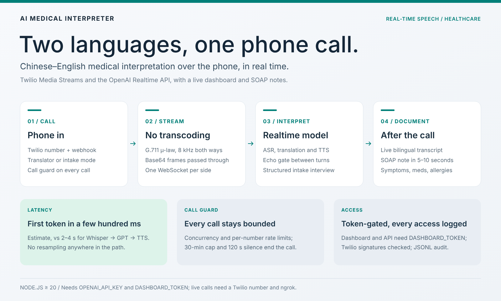
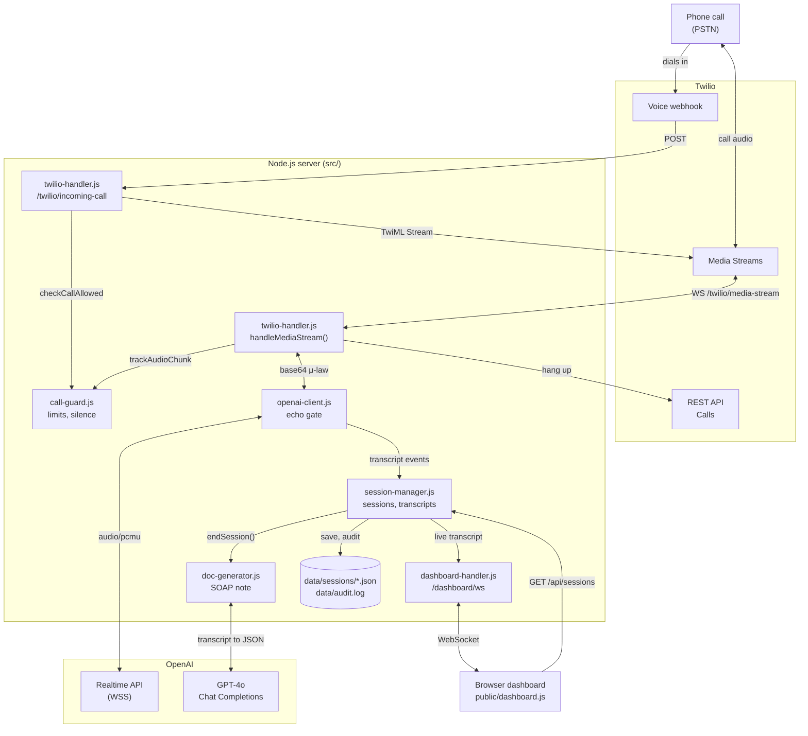

<div align="center">

# AI Medical Interpreter

**English** · [简体中文](README.zh-CN.md)

**Chinese–English medical interpretation over the phone, in real time.**


[](https://www.ccao2679.com/projects/#ai-medical-interpreter)



</div>

Real-time medical phone call interpretation service built on **Twilio Media Streams** + **OpenAI Realtime API**, with a live web dashboard and auto-generated SOAP clinical documentation.

A caller dials in, speaks Chinese — the other side hears English. Speaks English — hears Chinese. Expected end-to-end first-token latency: **a few hundred ms**.

<!-- problem-framing:start -->

## Problem and evidence

> **Can a telephone interpretation prototype preserve the meaning of bilingual turns through interruptions and connection failures while keeping response delay measurable and bounded?**

**Why it matters:** Missing a negation, number or speaker turn can change the meaning of a conversation. Low first-audio latency alone cannot establish faithful interpretation.

**Central tension:** Early responses reduce waiting, while premature turn completion and echo suppression may discard speech or create overlapping output. Generated summaries can also introduce statements absent from the call.

[Full problem and verification plan](PROBLEM.md) · [中文](PROBLEM.zh.md)

<!-- problem-framing:end -->

## What It Does

### Two Operating Modes

| Mode | What Happens | Use Case |
|------|-------------|----------|
| **Translator** | Pure bidirectional translation. AI is invisible — the two parties feel like they're talking to each other directly. | Provider and patient speaking different languages |
| **Intake** | AI acts as a medical intake operator. Conducts a structured interview following standard clinical intake protocol (chief complaint -> HPI -> medications -> allergies -> PMH -> family/social history -> ROS). | Pre-visit patient information collection |

### Live Dashboard

While a call is active, open `http://localhost:5050` in a browser:

- **Real-time bilingual transcript** — caller (blue) and translation/AI (green) with timestamps, streaming word-by-word
- **SOAP note auto-generation** — 5-10 seconds after call ends, a structured medical document appears with:
  - Chief Complaint, History of Present Illness, Medications, Allergies, Past Medical History
  - Assessment with differential diagnosis
  - Plan with recommendations, follow-up, referrals
  - Structured entity extraction (symptoms, medications, allergies, diagnoses, procedures)
- **HIPAA audit trail** — all data access logged to `data/audit.log`

### Call Protection

- **Concurrent call limit** (default: 5) — a call over `MAX_CONCURRENT_CALLS` hears a short message and is hung up.
- **Per-number rate limit** (default: 10 calls / 10 min) — the voice webhook checks how many calls from the caller's number (`From`) were connected in the last `RATE_LIMIT_WINDOW_MIN`. The number is passed to the media stream as a `<Parameter name="from">`, so every connected call is recorded under it; over the limit, the caller hears "Too many recent calls" and is hung up. The history is kept in memory, so it resets on restart and is not shared between server instances.
- **Max call duration** (default: 30 min) — the server ends the call: it adds a note to the transcript, closes the OpenAI session, completes the call through the Twilio REST API (`Status=completed`) and closes the media stream. The SOAP note is still generated.
- **Silence detection** — after `MAX_SILENCE_SEC` (default 60 s) with no speech, a warning is added to the transcript; after twice that (120 s) the call is ended the same way.
- Hanging up needs `TWILIO_ACCOUNT_SID` and `TWILIO_AUTH_TOKEN`. Without them, or if the REST request fails, the server logs a warning and closes the media stream, and the `<Hangup/>` after `<Connect>` in the TwiML ends the call.
- Rejections, silence warnings and forced hang-ups are written to the audit trail.

---

## Architecture



Read it top to bottom: call audio goes phone → Twilio → `twilio-handler.js` → `openai-client.js` → OpenAI Realtime and back the same way as base64 μ-law, with no transcoding. Transcript events fan out from `session-manager.js` to the dashboard over WebSocket; when the call ends, `doc-generator.js` sends the transcript to GPT-4o and the SOAP note is saved with the session. When `call-guard.js` reports the duration cap or extended silence, `twilio-handler.js` ends the call through Twilio's REST API.

<details>
<summary>Text version of the diagram</summary>

```
Phone (PSTN) ──► Twilio ──► /twilio/incoming-call?mode=translator|intake
                                │
                          ┌─────┴─────┐
                          │ Call Guard │ rate limit / max duration / silence
                          └─────┬─────┘
                                │
                    ┌───────────┴───────────┐
                    │ mode=translator       │ mode=intake
                    │ Bidirectional         │ Structured medical
                    │ translation           │ interview
                    └───────────┬───────────┘
                                │
                    OpenAI Realtime API (WSS)
                    speech-to-speech model, caller
                    transcripts by gpt-realtime-whisper
                    audio/pcmu 8kHz — zero resampling
                                │
                    ┌───────────┼───────────┐
                    │           │           │
              Dashboard WS   Audit Log   Doc Generator
              /dashboard/ws  append-only  GPT-4o Chat API
                    │          JSONL           │
                    ▼                          ▼
              Browser UI               SOAP Note (JSON)
            (live transcript)        (medical document)
```

</details>

**Why OpenAI Realtime API (not Whisper -> GPT -> TTS)?**

| Approach | Latency (estimate) | Complexity |
|----------|---------|------------|
| Whisper -> GPT-4 -> ElevenLabs | 2-4s | High (VAD, chunking, streaming glue) |
| **OpenAI Realtime API** | **a few hundred ms** | **Low (single WebSocket)** |

The Realtime API handles speech recognition, translation and speech output in one connection. Twilio streams **G.711 μ-law 8kHz**, and the Realtime session is configured with the same codec (`audio/pcmu`) for input and output, so the server does **zero audio encoding/decoding** — just passes base64 strings through.

---

## Quick Start

### Prerequisites

- Node.js >= 20
- OpenAI API key with Realtime API access
- Twilio account with a Voice-enabled phone number
- ngrok (for local development)

### Setup

```bash
git clone https://github.com/HenryVarro666/AI-medical-interpreter.git
cd AI-medical-interpreter

npm install

cp .env.example .env
# Edit .env — at minimum set OPENAI_API_KEY
```

Also set `TWILIO_ACCOUNT_SID` and `TWILIO_AUTH_TOKEN` so the server can end calls through the Twilio REST API (duration cap, silence hang-up), and `TWILIO_PHONE_NUMBER` to sync the webhook from the dashboard.

### Run

```bash
# Terminal 1: start the server
npm run dev

# Terminal 2: expose to public internet
ngrok http 5050
```

Configure your Twilio phone number's Voice Webhook:
```
https://<your-ngrok-host>.ngrok-free.app/twilio/incoming-call    (POST)
```

For intake mode, append `?mode=intake` to the webhook URL.

### Test

1. Open `http://localhost:5050` in a browser (dashboard)
2. Call your Twilio number from a phone
3. Speak — see live transcript appear in the browser
4. Hang up — SOAP note generates automatically

Automated tests (`node:test`; Twilio, OpenAI and network calls are faked, so no accounts are needed):

```bash
npm test
```

---

## Project Structure

```
.
├── src/
│   ├── server.js              # Express HTTP + dual WebSocket entry point
│   ├── twilio-handler.js      # TwiML, Media Streams ↔ OpenAI bridge, call hang-up
│   ├── openai-client.js       # OpenAI Realtime WebSocket client + echo gate
│   ├── session-manager.js     # Call session registry + transcript fan-out
│   ├── dashboard-handler.js   # Dashboard WebSocket connection handler
│   ├── call-guard.js          # Rate limiting, max duration, silence detection
│   ├── doc-generator.js       # GPT-4o SOAP note generation
│   ├── transcript-cleaner.js  # Optional GPT-4o-mini fix-up of caller transcripts
│   ├── twilio-sync.js         # Points the Twilio number's Voice webhook here
│   ├── medical-prompts.js     # Medical document generation prompts
│   ├── intake-prompts.js      # Intake operator conversation protocol
│   ├── prompts.js             # Translator system prompt (code-switching aware)
│   ├── audit-logger.js        # HIPAA-style append-only audit log
│   ├── tts-bridge.js          # Voice cloning interface (placeholder)
│   └── config.js              # Environment config + validation
├── public/
│   ├── index.html             # Dashboard page
│   ├── dashboard.js           # Dashboard client (WS + REST + rendering)
│   └── styles.css             # Medical-themed UI
├── test/                      # node:test suite (npm test), Twilio/OpenAI faked
├── docs/
│   ├── architecture.md        # System design + data flow diagrams
│   ├── technical-spec.md      # Full technical specification
│   ├── api-flow.md            # Twilio & OpenAI protocol details
│   ├── setup.md               # Step-by-step configuration guide
│   ├── aws-deploy.md          # AWS deployment guide (EC2 + nginx)
│   └── voice-cloning.md       # Voice cloning integration roadmap
├── Dockerfile                 # Container deployment
├── .env.example               # Environment variable template
└── package.json
```

---

## API Endpoints

### HTTP

| Endpoint | Method | Description |
|----------|--------|-------------|
| `/health` | GET | Health check + active call count |
| `/twilio/incoming-call` | POST, GET | Twilio Voice webhook (returns TwiML) |
| `/api/sessions` | GET | List all sessions (active + recent) |
| `/api/sessions/:id` | GET | Session detail with full transcript |
| `/api/sessions/:id/document` | GET | Generated SOAP note |
| `/api/public-host` | GET | Public host for the webhook URL (`PUBLIC_HOST` or the request host) |
| `/api/models` | GET | Selectable model keys and the per-mode defaults |
| `/api/twilio-config` | GET | Whether Twilio credentials are set, plus the masked phone number |
| `/api/twilio-sync` | POST | Set the Twilio number's Voice webhook to `{ "webhookUrl": "..." }` (needs `TWILIO_*`) |
| `/api/demo` | POST | Create a sample intake session from a scripted transcript (its SOAP note calls GPT-4o) |

### WebSocket

| Endpoint | Protocol | Description |
|----------|----------|-------------|
| `/twilio/media-stream` | Twilio Media Streams | Bidirectional call audio |
| `/dashboard/ws?sessionId=<id>` | JSON messages | Live transcript stream |

### Query Parameters

| Parameter | On | Values | Default |
|-----------|----|--------|---------|
| `mode` | `/twilio/incoming-call` | `translator`, `intake` | `DEFAULT_MODE` (`translator`) |
| `model` | `/twilio/incoming-call` | a key from `/api/models` (`gpt-4o-realtime`, `gpt-realtime`, `gpt-realtime-2`, `gpt-realtime-translate`, `gpt-realtime-whisper`) or a full model id | `OPENAI_MODEL` |

---

## Configuration

All configuration via environment variables (see `.env.example`):

### Required

| Variable | Description |
|----------|-------------|
| `OPENAI_API_KEY` | OpenAI API key with Realtime API access |

### Optional

| Variable | Default | Description |
|----------|---------|-------------|
| `PORT` | `5050` | Server port |
| `OPENAI_MODEL` | `gpt-4o-realtime-preview-2024-12-17` | Realtime model |
| `VOICE` | `alloy` | TTS voice (alloy/ash/ballad/coral/echo/sage/shimmer/verse) |
| `PUBLIC_HOST` | auto-detect | Public hostname for Twilio callbacks |
| `SPEAKER_A_LANG` | `Chinese` | First language |
| `SPEAKER_B_LANG` | `English` | Second language |
| `DEFAULT_MODE` | `translator` | Default session mode |
| `TWILIO_ACCOUNT_SID` | — | Twilio account; needed to hang up calls via the REST API and for webhook sync |
| `TWILIO_AUTH_TOKEN` | — | Twilio auth token (same uses) |
| `TWILIO_PHONE_NUMBER` | — | Number whose Voice webhook `/api/twilio-sync` updates (E.164) |
| `MAX_CONCURRENT_CALLS` | `5` | Max simultaneous calls |
| `MAX_CALL_DURATION_MIN` | `30` | End the call after N minutes |
| `MAX_SILENCE_SEC` | `60` | Warn after N seconds of silence; end the call after 2N |
| `RATE_LIMIT_MAX_CALLS` | `10` | Max calls per caller number (`From`) per window |
| `RATE_LIMIT_WINDOW_MIN` | `10` | Rate limit window in minutes |
| `WHISPER_LANGUAGE_HINT` | empty (auto) | ISO 639-1 hint for `gpt-realtime-whisper` input transcription |
| `ENABLE_TRANSCRIPT_CLEANING` | `false` | Correct caller transcripts with GPT-4o-mini (`transcript-cleaner.js`); audio is unaffected |
| `SESSION_TTL_MINUTES` | `60` | Keep ended sessions in memory |
| `AUDIT_LOG_PATH` | `data/audit.log` | Audit log file path |
| `DEBUG_LOG_TRANSCRIPTS` | `false` | Log transcript text to console (PHI warning) |

---

## Audio Pipeline

The key to sub-second latency: **zero resampling**.

```
Twilio sends:   u-law (G.711) 8kHz mono → base64 in JSON
Server:         pass-through (no decode/encode)
OpenAI:         audio/pcmu (G.711 u-law 8kHz) for input and output
Response:       audio/pcmu → base64 in JSON
Twilio plays:   u-law 8kHz directly to phone
```

Caller transcripts come from the session's input transcription model, `gpt-realtime-whisper` (biased by `WHISPER_LANGUAGE_HINT` if set, optionally corrected by `transcript-cleaner.js`).

### Echo Suppression

Phones without hardware echo cancellation pick up the AI's TTS output through the mic. The `openai-client.js` echo gate handles this:

1. AI starts speaking -> `aiSpeaking = true` -> all inbound audio dropped
2. AI finishes -> grace period (**800 ms** in translator mode, **2000 ms** in intake mode) -> `aiSpeaking = false` -> resume forwarding
3. In intake mode the gate is closed before the AI's opening greeting, so inbound audio can't cut it off

This effectively disables barge-in while the AI is speaking — the correct behavior for medical interpretation where accuracy matters more than interruptibility. The gate is skipped for `gpt-realtime-translate`, which uses the separate translation endpoint: there, inbound audio is always forwarded.

---

## Medical Document Generation

After a call ends, the full transcript is sent to **GPT-4o** (standard chat completions, not Realtime) to generate a structured SOAP note:

```json
{
  "metadata": { "disclaimer": "AI-generated draft — must be reviewed by qualified medical personnel" },
  "soapNote": {
    "subjective": {
      "chiefComplaint": "Headache for 3 days, unresponsive to ibuprofen",
      "historyOfPresentIllness": "...",
      "medications": "Ibuprofen 400mg PRN",
      "allergies": "Penicillin (rash)"
    },
    "assessment": { "summary": "...", "differentialDiagnosis": ["Tension headache", "Migraine"] },
    "plan": { "recommendations": ["...", "..."], "followUp": "..." }
  },
  "extractedEntities": {
    "symptoms": ["headache"],
    "medications": ["ibuprofen"],
    "allergies": ["penicillin"],
    "diagnoses": ["tension headache", "migraine"]
  }
}
```

**Intake mode** produces richer documents because the AI systematically collects each data point.

---

## Language Handling

### Supported Languages

Any language pair OpenAI Realtime supports. Change via `SPEAKER_A_LANG` / `SPEAKER_B_LANG`.

### Code-Switching (Mixed Language)

When a speaker mixes languages (e.g., "我昨天去了 Costco 买了 ibuprofen"), the system:

1. Detects the **dominant language** of the utterance
2. Translates the **entire sentence** into the other language
3. Preserves proper nouns, drug names, and medical terms in their original form

### Unintelligible Speech

- **Translator mode**: stays silent (no hallucinated output)
- **Intake mode**: politely asks the patient to repeat

---

## HIPAA Compliance Architecture

Designed in, not fully implemented (this is a proof-of-concept):

| Layer | Status | Detail |
|-------|--------|--------|
| Audit logging | Implemented | Append-only JSONL, all data access logged |
| Transport encryption | In place | WSS for Twilio, OpenAI, and dashboard |
| PHI log gating | Implemented | `DEBUG_LOG_TRANSCRIPTS` flag controls console output |
| Data lifecycle | Partial | Ended sessions leave memory after `SESSION_TTL_MINUTES`, but every completed session (transcript and SOAP note) is written to `data/sessions/<id>.json` and reloaded at startup |
| Access control | Architecture only | UUID-based session access (JWT/RBAC ready) |
| BAA agreements | Not in scope | Required for production (Twilio, OpenAI, hosting) |
| Encryption at rest | Not in scope | Add for production deployment |

---

## Deployment

### Docker

```bash
docker build -t ai-medical-interpreter .
docker run -p 5050:5050 --env-file .env ai-medical-interpreter
```

### AWS (EC2 + nginx)

See [docs/aws-deploy.md](docs/aws-deploy.md) for a full walkthrough. Estimated cost: ~$20-25/month for demo usage.

---

## Cost Estimate

Per minute of active call:

| Component | Translator Mode | Intake Mode |
|-----------|----------------|-------------|
| Twilio Voice | ~$0.013 | ~$0.013 |
| OpenAI Realtime (audio in) | ~$0.06 | ~$0.06 |
| OpenAI Realtime (audio out) | ~$0.24 | ~$0.24 |
| OpenAI GPT-4o (SOAP note) | ~$0.01/call | ~$0.01/call |
| **Per-minute total** | **~$0.31** | **~$0.31** |

With voice cloning (ElevenLabs): ~$0.18/min (cheaper — saves on OpenAI audio output tokens).

---

## Future Roadmap

- [ ] **Dual-person Conference mode** — A speaks Chinese, B hears English; B speaks English, A hears Chinese (architecture designed in [docs/architecture.md](docs/architecture.md))
- [ ] **Voice cloning** — custom TTS voices via ElevenLabs / Cartesia (interface defined in `tts-bridge.js`, roadmap in [docs/voice-cloning.md](docs/voice-cloning.md))
- [ ] **EHR integration** — push SOAP notes to Epic/Cerner via FHIR
- [ ] **User authentication** — JWT + RBAC for dashboard access control
- [ ] **Multi-session monitoring** — admin view of all active calls
- [ ] **Quality scoring** — post-call translation accuracy assessment
- [ ] **Low-resource language fallback** — route to human interpreter when AI confidence is low

---

## Tech Stack

| Layer | Technology |
|-------|-----------|
| Runtime | Node.js 20+, ES Modules |
| Web framework | Express 4 |
| WebSocket | ws 8 |
| Phone gateway | Twilio Voice + Media Streams |
| AI (real-time) | OpenAI Realtime API (`gpt-4o-realtime-preview` by default; `gpt-realtime`, `gpt-realtime-2`, `gpt-realtime-translate` selectable), `gpt-realtime-whisper` transcription |
| AI (documents) | OpenAI GPT-4o Chat Completions (GPT-4o-mini for optional transcript cleanup) |
| Frontend | Vanilla HTML/JS/CSS (no framework) |
| Deployment | Docker, nginx, AWS EC2 |

---

## Documentation

| Document | Content |
|----------|---------|
| [docs/architecture.md](docs/architecture.md) | System architecture, module responsibilities, data flow |
| [docs/technical-spec.md](docs/technical-spec.md) | Complete technical specification |
| [docs/setup.md](docs/setup.md) | Twilio / OpenAI / ngrok configuration steps |
| [docs/api-flow.md](docs/api-flow.md) | Twilio & OpenAI protocol details and message sequences |
| [docs/aws-deploy.md](docs/aws-deploy.md) | AWS deployment guide |
| [docs/voice-cloning.md](docs/voice-cloning.md) | Voice cloning integration roadmap |

---

## License

MIT
