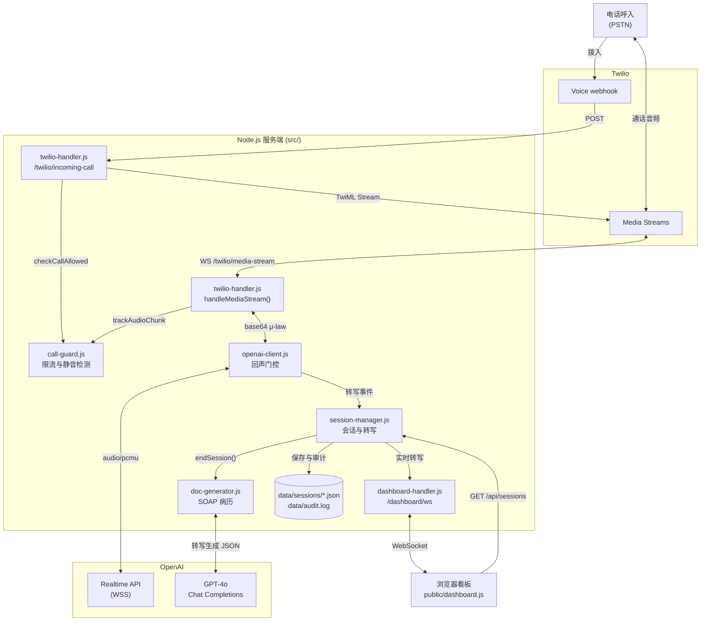

<div align="center">

# AI Medical Interpreter

[English](README.md) · **简体中文**

**实时的中英双语医疗电话口译。**


[](https://www.ccao2679.com/projects/#ai-medical-interpreter)


</div>

基于 **Twilio Media Streams** + **OpenAI Realtime API** 构建的实时医疗电话口译服务，配有实时 Web 看板，并能自动生成 SOAP 格式的临床文档。

来电者拨入后说中文，对方听到的是英文；说英文，对方听到的是中文。端到端首 token 延迟：**~400-800ms**。

<!-- problem-framing:start -->

## 问题与依据

> **电话口译原型能否在打断和连接故障下保住双语对话中每一轮的原意，同时让响应延迟可测量、有上界？**

**为什么值得解决：** 漏掉一个否定词、一个数字或一次说话人切换，都可能改变对话的意思。首段音频延迟低，本身并不能说明口译是忠实的。

**核心矛盾：** 提前响应能减少等待，但过早判定一轮结束、以及回声抑制，都可能丢掉语音或造成输出重叠。生成的摘要还可能引入通话中并不存在的内容。

[完整问题与验证方案](PROBLEM.zh.md)

<!-- problem-framing:end -->

## 功能

### 两种工作模式

| 模式 | 行为 | 适用场景 |
|------|-------------|----------|
| **Translator** | 纯双向翻译。AI 对通话双方是“隐形”的，双方感觉就像在直接交谈。 | 医护人员与患者语言不通 |
| **Intake** | AI 担任医疗问诊接待员，按标准临床问诊流程进行结构化问诊（主诉 -> 现病史（HPI）-> 用药 -> 过敏史 -> 既往史（PMH）-> 家族史/社会史 -> 系统回顾（ROS））。 | 就诊前采集患者信息 |

### 实时看板

通话进行时，在浏览器中打开 `http://localhost:5050`：

- **实时双语转写**：来电者（蓝色）与译文/AI（绿色）分色显示，带时间戳，逐词流式呈现
- **自动生成 SOAP 病历**：通话结束 5-10 秒后，会出现一份结构化医疗文档，包含：
  - 主诉、现病史、用药、过敏史、既往史
  - 评估，含鉴别诊断
  - 计划，含建议、随访、转诊
  - 结构化实体抽取（症状、药物、过敏、诊断、操作）
- **HIPAA 审计追踪**：所有数据访问都会记录到 `data/audit.log`

### 通话保护

- 并发通话上限（默认：5）
- 按号码限流（默认：10 分钟内 10 通）
- 最长通话时长（默认：30 分钟后自动断开）
- 静音检测：60 秒无语音后发出警告
- 所有拒接和警告都会写入审计日志

---

## 架构



从上往下看：通话音频沿 电话 → Twilio → `twilio-handler.js` → `openai-client.js` → OpenAI Realtime 传过去，再按原路以 base64 μ-law 传回，全程不做转码。转写事件由 `session-manager.js` 经 WebSocket 推送到看板；通话结束后，`doc-generator.js` 把转写发给 GPT-4o 生成 SOAP 病历，并随会话一起保存。

<details>
<summary>架构图的纯文本版</summary>

```
Phone (PSTN) ──► Twilio ──► /twilio/incoming-call?mode=translator|intake
                                │
                          ┌─────┴─────┐
                          │ Call Guard │ rate limit / max duration / silence
                          └─────┬─────┘
                                │
                    ┌───────────┴───────────┐
                    │ mode=translator       │ mode=intake
                    │ Bidirectional         │ Structured medical
                    │ translation           │ interview
                    └───────────┬───────────┘
                                │
                    OpenAI Realtime API (WSS)
                    ASR (Whisper) + LLM + TTS
                    g711_ulaw 8kHz — zero resampling
                                │
                    ┌───────────┼───────────┐
                    │           │           │
              Dashboard WS   Audit Log   Doc Generator
              /dashboard/ws  append-only  GPT-4o Chat API
                    │          JSONL           │
                    ▼                          ▼
              Browser UI               SOAP Note (JSON)
            (live transcript)        (medical document)
```

</details>

**为什么用 OpenAI Realtime API，而不是 Whisper -> GPT -> TTS？**

| 方案 | 延迟 | 复杂度 |
|----------|---------|------------|
| Whisper -> GPT-4 -> ElevenLabs | 2-4s | 高（VAD、分块、流式拼接） |
| **OpenAI Realtime API** | **300-800ms** | **低（单个 WebSocket）** |

Realtime API 在一条连接里完成 ASR、翻译和 TTS。Twilio 和 OpenAI 都原生支持 **G.711 u-law 8kHz**，因此服务端**完全不做音频编解码**，只是透传 base64 字符串。

---

## 快速开始

### 前置条件

- Node.js >= 20
- 有 Realtime API 权限的 OpenAI API key
- Twilio 账号，以及一个开通了 Voice 的电话号码
- ngrok（本地开发用）

### 安装

```bash
git clone https://github.com/HenryVarro666/AI-medical-interpreter.git
cd AI-medical-interpreter

npm install

cp .env.example .env
# Edit .env — at minimum set OPENAI_API_KEY
```

### 运行

```bash
# Terminal 1: start the server
npm run dev

# Terminal 2: expose to public internet
ngrok http 5050
```

为 Twilio 号码配置 Voice Webhook：
```
https://<your-ngrok-host>.ngrok-free.app/twilio/incoming-call    (POST)
```

如需使用 intake 模式，在 webhook URL 后追加 `?mode=intake`。

### 测试

1. 在浏览器中打开 `http://localhost:5050`（看板）
2. 用手机拨打你的 Twilio 号码
3. 开始说话，浏览器中会实时出现转写
4. 挂断电话，SOAP 病历会自动生成

---

## 目录结构

```
.
├── src/
│   ├── server.js              # Express HTTP + dual WebSocket entry point
│   ├── twilio-handler.js      # Twilio Media Streams ↔ OpenAI bridge
│   ├── openai-client.js       # OpenAI Realtime WebSocket client + echo gate
│   ├── session-manager.js     # Call session registry + transcript fan-out
│   ├── dashboard-handler.js   # Dashboard WebSocket connection handler
│   ├── call-guard.js          # Rate limiting, max duration, silence detection
│   ├── doc-generator.js       # GPT-4o SOAP note generation
│   ├── medical-prompts.js     # Medical document generation prompts
│   ├── intake-prompts.js      # Intake operator conversation protocol
│   ├── prompts.js             # Translator system prompt (code-switching aware)
│   ├── audit-logger.js        # HIPAA-style append-only audit log
│   ├── tts-bridge.js          # Voice cloning interface (placeholder)
│   └── config.js              # Environment config + validation
├── public/
│   ├── index.html             # Dashboard page
│   ├── dashboard.js           # Dashboard client (WS + REST + rendering)
│   └── styles.css             # Medical-themed UI
├── docs/
│   ├── architecture.md        # System design + data flow diagrams
│   ├── technical-spec.md      # Full technical specification
│   ├── api-flow.md            # Twilio & OpenAI protocol details
│   ├── setup.md               # Step-by-step configuration guide
│   ├── aws-deploy.md          # AWS deployment guide (EC2 + nginx)
│   └── voice-cloning.md       # Voice cloning integration roadmap
├── Dockerfile                 # Container deployment
├── .env.example               # Environment variable template
└── package.json
```

---

## API 接口

### HTTP

| 接口 | 方法 | 说明 |
|----------|--------|-------------|
| `/health` | GET | 健康检查 + 当前通话数 |
| `/twilio/incoming-call` | POST | Twilio Voice webhook（返回 TwiML） |
| `/api/sessions` | GET | 列出所有会话（进行中 + 最近结束） |
| `/api/sessions/:id` | GET | 会话详情及完整转写 |
| `/api/sessions/:id/document` | GET | 生成的 SOAP 病历 |

### WebSocket

| 接口 | 协议 | 说明 |
|----------|----------|-------------|
| `/twilio/media-stream` | Twilio Media Streams | 双向通话音频 |
| `/dashboard/ws?sessionId=<id>` | JSON 消息 | 实时转写流 |

### 查询参数

| 参数 | 作用于 | 取值 | 默认值 |
|-----------|----|--------|---------|
| `mode` | `/twilio/incoming-call` | `translator`, `intake` | `translator` |

---

## 配置

所有配置都通过环境变量完成（见 `.env.example`）：

### 必填

| 变量 | 说明 |
|----------|-------------|
| `OPENAI_API_KEY` | 有 Realtime API 权限的 OpenAI API key |

### 可选

| 变量 | 默认值 | 说明 |
|----------|---------|-------------|
| `PORT` | `5050` | 服务端口 |
| `OPENAI_MODEL` | `gpt-4o-realtime-preview-2024-12-17` | Realtime 模型 |
| `VOICE` | `alloy` | TTS 音色（alloy/ash/ballad/coral/echo/sage/shimmer/verse） |
| `PUBLIC_HOST` | 自动检测 | Twilio 回调使用的公网主机名 |
| `SPEAKER_A_LANG` | `Chinese` | 第一种语言 |
| `SPEAKER_B_LANG` | `English` | 第二种语言 |
| `DEFAULT_MODE` | `translator` | 默认会话模式 |
| `MAX_CONCURRENT_CALLS` | `5` | 最大同时通话数 |
| `MAX_CALL_DURATION_MIN` | `30` | N 分钟后自动断开 |
| `MAX_SILENCE_SEC` | `60` | 静音 N 秒后发出警告 |
| `RATE_LIMIT_MAX_CALLS` | `10` | 每个号码在时间窗口内的最大通话数 |
| `RATE_LIMIT_WINDOW_MIN` | `10` | 限流时间窗口（分钟） |
| `SESSION_TTL_MINUTES` | `60` | 已结束会话在内存中的保留时长 |
| `AUDIT_LOG_PATH` | `data/audit.log` | 审计日志文件路径 |
| `DEBUG_LOG_TRANSCRIPTS` | `false` | 在控制台打印转写文本（注意：含 PHI） |

---

## 音频链路

实现亚秒级延迟的关键：**零重采样**。

```
Twilio sends:   u-law (G.711) 8kHz mono → base64 in JSON
Server:         pass-through (no decode/encode)
OpenAI:         g711_ulaw 8kHz native support
Response:       g711_ulaw → base64 in JSON
Twilio plays:   u-law 8kHz directly to phone
```

### 回声抑制

没有硬件回声消除的电话，麦克风会把 AI 的 TTS 输出也录进去。`openai-client.js` 中的回声门控（echo gate）负责处理这个问题：

1. AI 开始说话 -> `aiSpeaking = true` -> 丢弃所有上行音频
2. AI 说完 -> 800ms 缓冲期 -> `aiSpeaking = false` -> 恢复转发

这实际上在翻译期间关闭了插话打断（barge-in）。医疗口译中准确比可打断更重要，所以这样做是对的。

---

## 医疗文档生成

通话结束后，完整转写会发给 **GPT-4o**（标准 Chat Completions，不是 Realtime），生成结构化的 SOAP 病历：

```json
{
  "metadata": { "disclaimer": "AI-generated draft — must be reviewed by qualified medical personnel" },
  "soapNote": {
    "subjective": {
      "chiefComplaint": "Headache for 3 days, unresponsive to ibuprofen",
      "historyOfPresentIllness": "...",
      "medications": "Ibuprofen 400mg PRN",
      "allergies": "Penicillin (rash)"
    },
    "assessment": { "summary": "...", "differentialDiagnosis": ["Tension headache", "Migraine"] },
    "plan": { "recommendations": ["...", "..."], "followUp": "..." }
  },
  "extractedEntities": {
    "symptoms": ["headache"],
    "medications": ["ibuprofen"],
    "allergies": ["penicillin"],
    "diagnoses": ["tension headache", "migraine"]
  }
}
```

**Intake 模式**生成的文档更完整，因为 AI 会系统地逐项采集每个数据点。

---

## 语言处理

### 支持的语言

支持 OpenAI Realtime 所支持的任意语言对，通过 `SPEAKER_A_LANG` / `SPEAKER_B_LANG` 修改。

### 语码转换（中英混说）

当说话人混用多种语言时（例如“我昨天去了 Costco 买了 ibuprofen”），系统会：

1. 判断这句话的**主导语言**
2. 把**整句话**翻译成另一种语言
3. 专有名词、药名和医学术语保留原文

### 无法识别的语音

- **Translator 模式**：保持沉默（不会凭空编造输出）
- **Intake 模式**：礼貌地请患者再说一遍

---

## HIPAA 合规架构

已在设计中考虑，但尚未完全实现（本项目是概念验证）：

| 层面 | 状态 | 说明 |
|-------|--------|--------|
| 审计日志 | 已实现 | 仅追加的 JSONL，记录所有数据访问 |
| 传输加密 | 已具备 | Twilio、OpenAI 和看板均使用 WSS |
| PHI 日志控制 | 已实现 | 由 `DEBUG_LOG_TRANSCRIPTS` 开关控制控制台输出 |
| 数据生命周期 | 部分实现 | 已结束的会话在 `SESSION_TTL_MINUTES` 后从内存清除，但每个完成的会话（转写与 SOAP 病历）都会写入 `data/sessions/<id>.json`，并在启动时重新加载 |
| 访问控制 | 仅有架构设计 | 基于 UUID 的会话访问（可接入 JWT/RBAC） |
| BAA 协议 | 不在范围内 | 生产环境必需（Twilio、OpenAI、托管服务商） |
| 静态数据加密 | 不在范围内 | 生产部署时需补充 |

---

## 部署

### Docker

```bash
docker build -t ai-medical-interpreter .
docker run -p 5050:5050 --env-file .env ai-medical-interpreter
```

### AWS (EC2 + nginx)

完整步骤见 [docs/aws-deploy.md](docs/aws-deploy.md)。演示用途的预估费用：~$20-25/月。

---

## 成本估算

每分钟有效通话的费用：

| 组成部分 | Translator 模式 | Intake 模式 |
|-----------|----------------|-------------|
| Twilio Voice | ~$0.013 | ~$0.013 |
| OpenAI Realtime（音频输入） | ~$0.06 | ~$0.06 |
| OpenAI Realtime（音频输出） | ~$0.24 | ~$0.24 |
| OpenAI GPT-4o（SOAP 病历） | ~$0.01/通 | ~$0.01/通 |
| **每分钟合计** | **~$0.31** | **~$0.31** |

使用声音克隆（ElevenLabs）时约为 ~$0.18/分钟（更便宜，因为省下了 OpenAI 音频输出 token 的费用）。

---

## 路线图

- [ ] **双人会议模式**：A 说中文，B 听到英文；B 说英文，A 听到中文（架构设计见 [docs/architecture.md](docs/architecture.md)）
- [ ] **声音克隆**：通过 ElevenLabs / Cartesia 定制 TTS 音色（接口定义在 `tts-bridge.js`，路线图见 [docs/voice-cloning.md](docs/voice-cloning.md)）
- [ ] **EHR 集成**：通过 FHIR 把 SOAP 病历推送到 Epic/Cerner
- [ ] **用户认证**：用 JWT + RBAC 控制看板访问
- [ ] **多会话监控**：管理员可查看所有进行中的通话
- [ ] **质量评分**：通话结束后评估翻译准确度
- [ ] **低资源语言兜底**：AI 置信度低时转接人工口译员

---

## 技术栈

| 层级 | 技术 |
|-------|-----------|
| 运行时 | Node.js 20+, ES Modules |
| Web 框架 | Express 4 |
| WebSocket | ws 8 |
| 电话网关 | Twilio Voice + Media Streams |
| AI（实时） | OpenAI Realtime API (gpt-4o-realtime) |
| AI（文档） | OpenAI GPT-4o Chat Completions |
| 前端 | 原生 HTML/JS/CSS（不使用框架） |
| 部署 | Docker, nginx, AWS EC2 |

---

## 文档

| 文档 | 内容 |
|----------|---------|
| [docs/architecture.md](docs/architecture.md) | 系统架构、模块职责、数据流 |
| [docs/technical-spec.md](docs/technical-spec.md) | 完整技术规格 |
| [docs/setup.md](docs/setup.md) | Twilio / OpenAI / ngrok 配置步骤 |
| [docs/api-flow.md](docs/api-flow.md) | Twilio 与 OpenAI 协议细节及消息时序 |
| [docs/aws-deploy.md](docs/aws-deploy.md) | AWS 部署指南 |
| [docs/voice-cloning.md](docs/voice-cloning.md) | 声音克隆集成路线图 |

---

## 许可证

MIT
